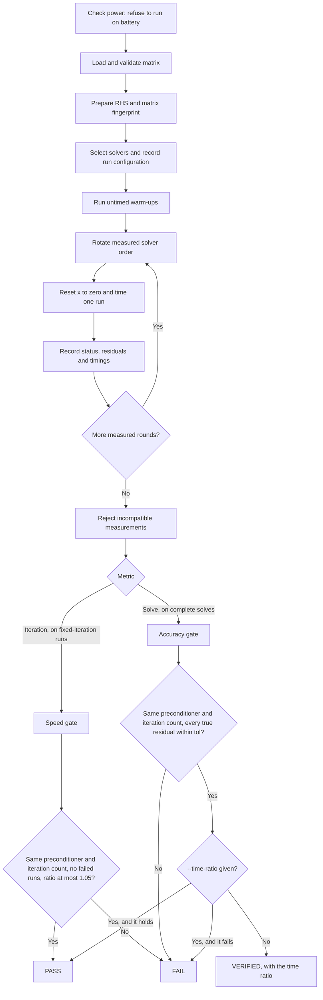

# Sequential Benchmark Flow

This document describes the sequential solver and kernel benchmarks. Solver parallelism, SELL and thread scaling are not part of the current delivery.

## The two gates

G1 is the sequential solver matching Eigen. A complete solve on every real matrix, repeated enough to compare times, would take days, so G1 is split in two:

| Gate | Runs | Passes when |
| --- | --- | --- |
| Speed | `--mode fixed --maxit 100`, summarized with `--metric iteration` | Time per iteration is at most 1.05 times Eigen's, iteration counts match, and no run failed |
| Accuracy | `--mode solve`, summarized with the default metric | Every true residual meets the tolerance and iteration counts match |

Iteration counts match when they differ by at most 1%, or by 1 iteration. Reaching the iteration limit is expected in a speed run and fails an accuracy run. A breakdown fails both. Each gate refuses runs made for the other, so a fast run that never converged cannot pass.

## Steps

1. **Check the power source.** `run_bench.py` refuses to run on battery, because that once made the same run about twice as slow and far noisier. `--allow-battery` overrides this. The source is recorded in the CSV, and `summarize.py` warns about battery rows.
2. **Prepare the problem.** Load and validate the matrix, create the right-hand side, record a fingerprint of the matrix contents, and collect machine and build details. Every solver starts from x = 0.
3. **Choose the right-hand side.** `--problem` selects it:
   - `random` (the default): b = A·x for a fixed random x. Every machine gets the same x, because the generator's output is defined by the C++ standard.
   - `a1`: b = A·1. The rows of A·1 can nearly cancel, which leaves a b close to rounding noise. On `tmt_sym` with Jacobi, the recursive residual reaches 1e-8 while the true residual stays at 1.7e-7, so the tolerance is out of reach.
   - `unit`: b = 1.
4. **Warm up.** `--warmup` rounds (default 1) run the same workload and are not recorded. `--repeat` rounds (default 10) are measured. Complete solves on large matrices are long enough that `--warmup 0` loses nothing.
5. **Measure.** Solvers run interleaved in one process, and the first solver rotates each round, because whichever ran first measured about 20% slower. Each recorded run includes its independent residual check, timed separately from the solve.
6. **Compare equivalent setups.** Eigen is built without its parallel runtime. Setup time includes building sparse storage on both sides.
7. **Summarize.** Times are medians, and ratios are the median of each round's paired ratio with a 95% nonparametric interval (Hoefler and Belli, SC15). Runs that differ in hardware, input, right-hand side, tolerance or an unlabeled build are rejected instead of pooled. `--label` allows comparing builds on purpose.
8. **Read the time columns correctly.**
   - `solve_s` covers the CG call, including its workspace allocation, and excludes verification, printing and file output.
   - `end_to_end_s` (`--metric end-to-end`) adds problem preparation, setup and verification. It is not a cold-process measurement.
   - `per_spmv_s` keeps its name for older CSVs, but means time per CG iteration, not an isolated SpMV.
9. **Read kernel bandwidth correctly.** GB/s from `bench_kernels` comes from a minimum-byte traffic model, not a measurement of DRAM traffic. Each kernel sample starts from the same vectors. Repeated SpMV acts as a power iteration, which would otherwise spread values over a range that never occurs in CG, so its output is rescaled every 8 calls and a non-finite value stops the run.

## Checking against SciPy

`scripts/check_against_scipy.py` runs `solve` on a Matrix Market file and checks the result with SciPy's own arithmetic: the residual, the answer compared with a direct solve on small matrices or SciPy's Jacobi CG on large ones, and SciPy's iteration count.

## Relevant Code

- Solver benchmark and CSV rows: [`apps/bench_cg.cpp`](../apps/bench_cg.cpp)
- Kernel timing: [`bench/kernel_timing.hpp`](../bench/kernel_timing.hpp), [`apps/bench_kernels.cpp`](../apps/bench_kernels.cpp)
- Suite runner and power check: [`scripts/run_bench.py`](../scripts/run_bench.py)
- Compatibility checks, statistics and gates: [`scripts/summarize.py`](../scripts/summarize.py)
- Commands to run: [`README.md`](../README.md)
