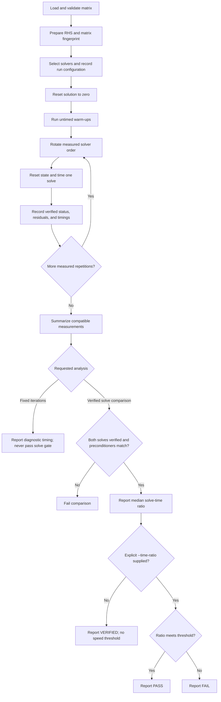

# Sequential Benchmark Flow

This document describes the current sequential solver and kernel benchmark
workflow. Solver parallelism, SELL metrics, and thread-scaling experiments are
deferred to the next delivery.



## Steps

1. **Prepare the problem.** Load and validate the matrix, create the demo RHS,
   record a fingerprint of the matrix contents, and collect machine/build
   metadata. Each solver starts from the same zero initial guess.
2. **Warm up.** Run the same solver workload for `--warmup` untimed rounds
   (default `1`). Warm-up results are not written as measured samples. The
   `--repeat` count (default `10`) controls the measured rounds.
3. **Measure solves.** Rotate the first solver between measured rounds to
   reduce ordering bias. Each recorded solve includes its independent residual
   verification. The solver's solve timer excludes verification; verification
   is recorded separately.
4. **Compare equivalent setups.** Eigen is explicitly built without its
   parallel runtime. Our backend and Eigen both include sparse storage
   construction in setup timing. The primary comparison uses full solve time;
   `solve_time / iteration_count` is reported as time per iteration, not as an
   isolated SpMV measurement.
5. **Use the right analysis mode.** Default `solve` mode expects convergence.
   `fixed` mode (with an explicit `--maxit`) is for fixed-work diagnostics.
   Fixed-iteration measurements cannot pass a verified-solve gate.
6. **Summarize safely.** The summarizer checks true residual against tolerance,
   solver status, preconditioner agreement, and run compatibility. Missing or
   incompatible measurements cannot count as a passing comparison. Without
   `--time-ratio`, it reports `VERIFIED` plus the runtime ratio; supply an
   explicit threshold to request `PASS`/`FAIL`.
7. **Interpret timing correctly.** Choose `--metric solve` (default) or
   `--metric end-to-end`. End-to-end adds shared problem preparation to the
   solver's setup, solve, and verification. Neither metric includes CSV writing
   or console output. `--metric iteration` is diagnostic only and cannot be
   used for solve gates.
8. **Interpret bandwidth correctly.** Kernel benchmark GB/s is derived from a
   minimum-byte traffic model. It is not a measurement of DRAM traffic.

## Reproduction

```bash
python3 scripts/run_bench.py \
  --build build/release \
  --solvers eigen-E0,ours,eigen-E1,ours-jacobi \
  --warmup 1 --repeat 10 \
  --out results/my-machine/seq-solve.csv

python3 scripts/summarize.py results/my-machine/seq-solve.csv \
  --gate eigen-E0=ours --gate eigen-E1=ours-jacobi
```

For a fixed-iteration diagnostic, pass `--mode fixed --maxit N` to
`run_bench.py`, then summarize with `--metric iteration` and no solve gate.
Existing CSVs are not overwritten by these example commands; use a new output
path for each run/configuration.

## Relevant Code

- Solver benchmark and CSV rows: [`apps/bench_cg.cpp`](../apps/bench_cg.cpp)
- Kernel microbenchmark: [`apps/bench_kernels.cpp`](../apps/bench_kernels.cpp)
- Suite runner: [`scripts/run_bench.py`](../scripts/run_bench.py)
- Compatibility checks, statistics, and gates: [`scripts/summarize.py`](../scripts/summarize.py)
- Usage and timing definitions: [`README.md`](../README.md)
