# Profiling po metodama i optimizacija: 21. novembar 2026.

Projekat P08: sekvencijalni CG solver za rijetke sisteme, upoređen sa Eigenom. Matrica: `thermal2` (1.228.045 redova, 8.580.313 nenultih elemenata, oko 7 po redu). Računar: laptop sa i5-1335U, Ubuntu 24.04, Intel VTune 2026.6, na struji, jedna performansna jezgra.

## Ukratko (prvi slajd)

Profesor je tražio tri stvari. Odgovor na svaku:

| Zahtjev | Šta je urađeno |
| --- | --- |
| Svaka od 9 metoda se profilira posebno, svaka ima svoj `main` | 9 zasebnih programa u `apps/methods/`, svaki se profilira sam, u svom VTune pokretanju. VTune mjeri samo iteracije, ne učitavanje fajla. |
| Popraviti memory bound, CPI i bad speculation | Bad speculation pao sa 22 do 34% na **0 do 8%**. CPI pao sa 0,62 do 0,78 na **0,41 do 0,59**. Memory bound kao **postotak** je porastao za 1 do 9 poena, jer je ostalo čekanje uklonjeno, ali stvarno **vrijeme** čekanja na memoriju je palo kod svih metoda, do 39% (tačka 5). |
| Histogram iskorištenosti treba biti pomjeren udesno | Histogram propusnosti memorije je pomjeren skroz udesno: vrijeme na visokoj propusnosti sa 19 do 54% na **99%** za metode sa prekondicionerom. Histogram jezgri ostaje na 1 jer je kod sekvencijalan, i to je sljedeći korak: paralelizacija. |

Naše metode su **1,1 do 1,9 puta brže** po iteraciji, a broj iteracija je ostao isti (±2). U odnosu na Eigen: Jacobi 21,2 s naspram Eigenovih 35,9 s, nepotpuni Cholesky 27,4 s naspram 41,2 s.

### Glavna tabela: prije → poslije

Sve vrijednosti su iz VTune-a, `thermal2`, jedna performansna jezgra. „Visoka propusnost" je udio vremena koji VTune svrstava u desni (visoki) dio histograma propusnosti memorije.

| Metoda | ms po iteraciji | Ubrzanje | CPI | Bad speculation | Memory bound | Propusnost (GB/s) | Visoka propusnost | Iteracije |
| --- | ---: | ---: | ---: | ---: | ---: | ---: | ---: | ---: |
| `cg_jacobi` | 11,87 → **9,01** | 1,32× | 0,72 → **0,59** | 21,6% → **0,0%** | 30,7% → 39,4% | 20,9 → **24,4** | 99% → 99% | 2.347 → 2.347 |
| `cg_sell_jacobi` | 9,49 → **8,54** | 1,11× | 0,93 → **0,89** | 0,3% → 0,4% | 50,1% → **49,1%** | 26,3 → 26,0 | 100% → 100% | 2.346 → 2.348 |
| `cg_sgs` | 33,42 → **17,91** | 1,87× | 0,62 → **0,50** | 23,5% → **7,5%** | 22,9% → 26,0% | 17,7 → **23,4** | 54% → **99%** | 992 → 992 |
| `cg_ic` | 32,42 → **18,01** | 1,80× | 0,76 → **0,49** | 30,7% → **7,8%** | 20,2% → 25,0% | 14,8 → **22,9** | 20% → **100%** | 1.525 → 1.524 |
| `cg_ic_fixed` | 32,38 → **17,93** | 1,81× | 0,76 → **0,49** | 30,7% → **7,9%** | 20,2% → 25,3% | 14,7 → **22,8** | 19% → **100%** | 1.297 → 1.299 |
| `cg_ic0` | 27,57 → **17,59** | 1,57× | 0,78 → **0,49** | 33,8% → **7,6%** | 20,2% → 25,3% | 16,5 → **23,1** | 24% → **100%** | 927 → 927 |
| `cg_ic0_rcm` | 23,37 → **13,68** | 1,71× | 0,66 → **0,41** | 28,8% → **7,9%** | 17,5% → 18,7% | 18,8 → **26,5** | 90% → **100%** | 753 → 751 |
| `eigen_e1` (kontrola) | 15,29 → 15,31 | 1,00× | 0,76 → 0,76 | 15,0% → 15,1% | 39,5% → 39,5% | 21,5 → 21,5 | 100% → 100% | 2.346 |
| `eigen_e4` (kontrola) | 36,44 → 36,38 | 1,00× | 0,73 → 0,73 | 26,1% → 26,1% | 20,9% → 20,9% | 14,5 → 14,5 | 27% → 26% | 1.133 |

Brojke za svaku metodu: `results/i5-1335U-linux/vtune-methods/baseline/metrics.md` (prije), `.../optimized/metrics.md` (poslije) i `.../comparison.md` (poređenje).

## 1. Kako se mjeri

### Devet programa, devet zasebnih profila

Ranije su sve metode išle kroz jedan program (`solve` sa opcijama). Sada svaka metoda ima svoj izvršni fajl sa svojim `main`:

| Program | Metoda |
| --- | --- |
| `cg_jacobi` | CG + Jacobi, CSR format |
| `cg_sell_jacobi` | CG + Jacobi, SELL-8-256 format |
| `cg_sgs` | CG + simetrični Gauss-Seidel |
| `cg_ic` | CG + nepotpuni Cholesky, tačno kao Eigen (sa Eigenova dva buga) |
| `cg_ic_fixed` | isto, ali sa ispravljena oba buga |
| `cg_ic0` | CG + IC(0) |
| `cg_ic0_rcm` | CG + IC(0) na matrici preuređenoj RCM-om |
| `eigen_e1` | Eigenov CG + Jacobi (poređenje) |
| `eigen_e4` | Eigenov CG + nepotpuni Cholesky (poređenje) |

### VTune mjeri samo iteracije

VTune se pokreće pauziran (`-start-paused`). Program ga sam uključi tačno prije prve iteracije i isključi poslije zadnje, preko Intelove ITT biblioteke (`__itt_resume` / `__itt_pause`). Zato u brojkama nema čitanja fajla od 163 MB ni pravljenja prekondicionera, nego samo ono što profesora zanima: sama metoda.

### Isti uslovi za sve

- Svaka metoda radi na **istoj jezgri** (performansna jezgra 0, `taskset -c 0`).
- Tri analize po metodi, svaka u svom pokretanju: **Hotspots** (gdje ide vrijeme), **Microarchitecture Exploration** (CPI, bad speculation, memory bound) i **Memory Access** (propusnost memorije).
- Za vrijeme mjerenja bilježimo temperaturu i frekvenciju. Prosječna frekvencija je bila 4,5 do 4,6 GHz u svim mjerenjima (VTune: „Average CPU Frequency"), i prije i poslije. Procesor povremeno dostiže 100 °C, ali frekvencija ostaje ista, pa poređenje nije narušeno.

### Kontrolna grupa: Eigen

Eigenov kod nismo mijenjali, pa njegove brojke moraju ostati iste. I jesu: CPI 0,76 → 0,76, bad speculation 15,0% → 15,1%, vrijeme 35,86 s → 35,91 s. To znači da je šum mjerenja ispod 0,5%, pa su promjene kod naših metoda stvarne, a ne slučajne.

## 2. Šta znače brojevi (jednostavno)

Procesor je kao fabrička traka sa 6 mjesta po taktu. Svako mjesto u svakom taktu može:

- **Retiring**: uraditi koristan posao. Što više, to bolje.
- **Bad speculation**: uraditi posao koji se baci. Procesor ne čeka da zna kuda ide petlja, nego pogađa i radi unaprijed. Ako pogriješi, sav taj posao baca. Što manje, to bolje.
- **Memory bound**: čekati podatke iz memorije. Što manje, to bolje, ali vidi tačku 5.
- **Front-end / core bound**: čekati instrukcije ili slobodnu računsku jedinicu.

**CPI** (cycles per instruction) je koliko taktova u prosjeku traje jedna instrukcija. Što manje, to bolje. Procesor može završiti do 6 instrukcija po taktu, pa je teoretski minimum oko 0,17.

**Histogram propusnosti** pokazuje koliko vremena program troši na niskoj, srednjoj i visokoj propusnosti memorije. Pomjeren udesno znači da program koristi memoriju punom brzinom.

**Histogram iskorištenosti jezgri** (Effective CPU Utilization) pokazuje koliko jezgri radi istovremeno. Naš kod je sekvencijalan, pa je uvijek 1 od 12. Pomjeriće se udesno tek sa paralelizacijom.

## 3. Šta je VTune pokazao prije optimizacije

| Metoda | CPI | Bad speculation | Memory bound | Najtoplija funkcija |
| --- | ---: | ---: | ---: | --- |
| `cg_jacobi` | 0,72 | 21,6% | 30,7% | množenje matrice i vektora (74%) |
| `cg_sgs` | 0,62 | 23,5% | 22,9% | Gauss-Seidel (61%) |
| `cg_ic` | 0,76 | 30,7% | 20,2% | primjena prekondicionera (62%) |
| `cg_ic0` | 0,78 | 33,8% | 20,2% | primjena prekondicionera (56%) |

Glavni problem je **bad speculation**: trećina rada procesora se bacala. Razlog je jednostavan. Red matrice `thermal2` ima 5 do 9 elemenata, a u trokutu prekondicionera 0 do 7, i to bez ikakvog reda (izmjereno: niz redova iste dužine je u prosjeku dug 1,5 reda). Petlja preko jednog reda završi poslije nekoliko krugova, procesor svaki put pogađa koliko, i često pogriješi.

## 4. Šta smo promijenili

Četiri promjene, svaka zbog nečega što je VTune pokazao.

### 4.1 Množenje matrice i vektora bez grananja (`masked_row.hpp`)

**Problem:** petlja `for k in red` ima različit broj krugova za svaki red, pa procesor pogađa kraj reda i griješi.

**Ideja:** svaki red čitamo kao **8 elemenata odjednom** (AVX2, dva registra po 4 broja). Elementi poslije kraja reda se **isključe maskom**, ne uslovom. Tako je posao za svaki red isti, bez obzira koliko je dug, i nema šta da se pogađa. Samo redovi duži od 8 (2,7% redova) idu kroz petlju.

Matrica ostaje obični CSR i čita se redom, pa nema dodatnog čitanja iz memorije.

**Rezultat:** bad speculation u `cg_jacobi` sa 21,6% na **0,0%**.

### 4.2 Jedan brzi kernel za sve trokutaste prekondicionere (`triangular.hpp`)

Gauss-Seidel, IC(0) i oba nepotpuna Choleskyja izgledaju različito, ali su matematički isti oblik: **M = K·Kᵀ**, gdje je K donje trokutasta matrica. Zato smo napisali **jedan** kernel za sva četiri. Pet trikova:

1. **Bez grananja:** redovi su podijeljeni u blokove od 8, i svaki red bloka je dopunjen nulama do najdužeg reda u bloku. Unutar bloka petlja ima fiksnu dužinu i kompajler je potpuno razmota.
2. **Susjed ostaje u registru:** element (i, i−1) čuvamo posebno. Vrijednost upravo izračunatog reda koristi se iz registra, bez upisa u memoriju i ponovnog čitanja.
3. **Oba prolaza čitaju redom:** gornji trokut (Kᵀ) čuvamo po redovima. Zato i povratni prolaz sabira, umjesto da razbacuje upise po memoriji.
4. **Manje prolaza kroz memoriju:** ažuriranje x i r (korak CG-a) radi se **unutar** prolaza unaprijed, a r·z unutar povratnog. Vektori se ne čitaju ponovo u posebnim petljama.
5. **Pola bajtova po koeficijentu:** K čuvamo kao `float` (4 bajta umjesto 8), a računamo u `double`. Prekondicioner je ionako aproksimacija. CG i dalje množi sa A u punoj preciznosti i provjerava pravi rezidual. IC(0) i Gauss-Seidel trebaju **isti** broj iteracija kao stari kod u `double` na pet matrica (thermal2, apache2, tmt_sym, ecology2, G3_circuit). Ako neki koeficijent ne stane u `float`, faktor automatski ostaje u `double`.

Za Gauss-Seidel postoji i matematička ušteda: iz M = (D+L)·D⁻¹·(D+U) slijedi da prolaz unaprijed treba samo donji trokut, a povratni samo gornji. Ranije su oba čitala cijelu matricu.

**Rezultat:** bad speculation sa 29 do 34% na **8%**, CPI sa 0,76 na **0,49**. Prekondicioner više nije najtoplija funkcija: sada je to množenje matrice i vektora (41% vremena).

### 4.3 Jacobi kao CG na skaliranom sistemu (`jacobi_scaled.hpp`)

**Ideja:** CG sa Jacobi prekondicionerom daje **iste iteracije** kao obični CG na sistemu  = D^(−1/2)·A·D^(−1/2) (Saad, *Iterative Methods for Sparse Linear Systems*, 9.2.1).  ima **jedinice na dijagonali**, pa dijagonalu ne moramo čuvati:

- 1,23 miliona elemenata manje za čitanje u svakom množenju (sedmina matrice),
- novi smjer p = r + β·p više ne treba čitati niz `1/aᵢᵢ`.

Kriterij zaustavljanja ostaje tačno ‖r‖ < tol·‖b‖ na originalnom sistemu. Broj iteracija: 2.347 prije, 2.347 poslije.

**Rezultat:** `cg_jacobi` sa 11,9 na **9,0 ms** po iteraciji, `cg_sell_jacobi` sa 9,5 na **8,5 ms**.

### 4.4 Mjerenje samo metode

Opisano u tački 1. Ovo nije ubrzanje, ali je bitno za tačne brojke: ranije su CPI i bad speculation uključivali i parsiranje teksta matrice, koje ima svoj, drugačiji profil.

## 5. Zašto je memory bound porastao (i zašto je to dobro)

Memory bound je **udio** vremena u kojem procesor čeka memoriju, ne količina čekanja. Kad uklonimo bacanje posla (bad speculation), ukupno vrijeme se smanji brže nego čekanje na memoriju. Zato udio čekanja poraste, iako samog čekanja ima manje. Primjer `cg_ic0`:

| | Prije | Poslije |
| --- | ---: | ---: |
| Vrijeme po iteraciji | 27,6 ms | 17,6 ms |
| Bad speculation | 33,8% | 7,6% |
| Retiring (koristan posao) | 23,1% | 42,4% |
| Memory bound (udio) | 20,2% | 25,3% |
| Propusnost memorije, prosjek | 16,5 GB/s | 23,1 GB/s |
| Vrijeme na visokoj propusnosti | 24% | 100% |

**Najvažnije: stvarno čekanje na memoriju se smanjilo kod svih metoda.** Udio (%) puta vrijeme po iteraciji daje koliko milisekundi po iteraciji procesor zaista čeka memoriju:

| Metoda | Čekanje na memoriju prije | Poslije |
| --- | ---: | ---: |
| `cg_jacobi` | 3,64 ms | 3,55 ms |
| `cg_sell_jacobi` | 4,75 ms | 4,19 ms |
| `cg_sgs` | 7,65 ms | **4,66 ms** |
| `cg_ic` | 6,55 ms | **4,50 ms** |
| `cg_ic_fixed` | 6,54 ms | **4,54 ms** |
| `cg_ic0` | 5,57 ms | **4,45 ms** |
| `cg_ic0_rcm` | 4,09 ms | **2,56 ms** |

Dakle memory bound kao **postotak** je porastao, a memory bound kao **vrijeme** je pao, kod `cg_sgs` za 39%, kod `cg_ic0_rcm` za 37%.

Program sada vuče podatke iz memorije brzinom od 23 do 26 GB/s, što VTune za ovaj računar navodi kao maksimum (25 GB/s), pa skoro sve vrijeme provodi u desnom dijelu histograma propusnosti. Ostao je posao koji se ne može izbjeći: matricu od 100 MB moramo pročitati u svakoj iteraciji.

Memory bound se smanjuje samo ako čitamo **manje bajtova**. Zato smo to i radili: Jacobi bez dijagonale (−14% matrice), `float` faktor (−⅓ prekondicionera), spojene petlje (manje prolaza kroz vektore). Svaka od tih promjena je ubrzala kod.

**Dvije bitne napomene za profesora:**

- Kod Jacobija i SELL-a memory bound je 39 do 49% jer je to čisto čitanje memorije: jedno množenje i sabiranje po 12 bajtova. Takav kod je po prirodi ograničen memorijom (memory-bound), i to je fizika, a ne greška u kodu.
- Ovo je upravo stanje koje se traži prije paralelizacije. Jedna jezgra više ne gubi vrijeme na pogrešna pogađanja i drži memoriju zauzetom. Jedna jezgra može imati samo ograničen broj zahtjeva prema memoriji u isto vrijeme, pa očekujemo da više jezgri zajedno izvuče više; koliko, pokazaće mjerenje sa nitima.

## 6. Zašto CPI 0,2 nije realan za ovaj kod

- Teoretski minimum za ovaj procesor je oko 0,17 (6 instrukcija po taktu). Do toga dolazi samo kod koji ne čita memoriju, npr. čisto računanje u registrima.
- Naš kod po svakom učitanom broju iz memorije uradi samo jedno množenje i jedno sabiranje. Takav kod (SpMV) na svim procesorima ima CPI oko 0,5 do 1.
- **CPI može porasti i kad je kod brži.** Kad isti posao uradimo sa manje instrukcija (vektorske instrukcije rade 4 broja odjednom), dijelimo vrijeme na manje instrukcija. `cg_sell_jacobi` je najbrža Jacobi metoda, a ima najveći CPI (0,89).

Spustili smo CPI na 0,41 do 0,59 za naše CSR metode (SELL: 0,89). To je dobra vrijednost za ovakav kod.

## 7. Šta smo probali, a nije uspjelo

Ovo je korisno pokazati: nije svaka ideja dobra, i samo mjerenje to otkriva.

1. **Grupisanje redova po dužini** (unutar prozora od 512 redova, prvo svi redovi dužine 7, pa dužine 8, ...). Grananja jesu nestala, ali je kod postao **sporiji** (13,8 umjesto 11,9 ms). Redovi se više ne čitaju redom, pa hardverski prefetcher ne zna unaprijed šta treba učitati.
2. **Velike stranice memorije (huge pages, 2 MB).** Trebale su smanjiti promašaje TLB-a. Kod je postao **sporiji** (15,3 umjesto 11,4 ms). Svi vektori su počinjali na istoj adresi modulo 2 MB, pa su svi tokovi udarali u iste banke memorije i iste setove keša. Sa pomjerenim početkom ubrzanje je bilo ispod 2%, pa smo ih izbacili.
3. **Maskirano čitanje (kao u 4.1) bez eksplicitnih AVX2 instrukcija.** GCC je maske pretvorio nazad u grananja i kod je bio 2 puta sporiji. Zato `masked_row.hpp` koristi AVX2 instrukcije direktno.

## 8. Rezultati po metodi

Najtoplija funkcija je funkcija sa najviše CPU vremena (VTune Hotspots, ugrađene pomoćne funkcije pripisane funkciji koja ih poziva).

- **`cg_jacobi` (CSR):** 1,32× brže. Bad speculation 21,6% → 0,0% (maskirani redovi, 4.1); 14% manje bajtova po množenju (skalirani sistem bez dijagonale, 4.3). Memory bound 39%: ostalo je čisto čitanje memorije, 24,4 GB/s.
- **`cg_sell_jacobi` (SELL):** 1,11× brže. SELL već nije imao grananja (bad speculation 0,3%), pa je ovdje dobit samo od skaliranog sistema (4.3). Memory bound 49%: najbrža Jacobi metoda i najbliža granici memorije.
- **`cg_sgs`:** 1,87× brže, najveći skok. Novi kernel (4.2) i matematika: svaki prolaz čita samo pola matrice. Najtoplija funkcija prije: `SymGaussSeidel::apply` 61%; poslije: množenje matrice 41%.
- **`cg_ic` (Eigenov faktor):** 1,80× brže. Faktor je i dalje Eigenov, operacija za operacijom; samo se primjenjuje novim kernelom. 1,50× brži od samog Eigena (`eigen_e4`).
- **`cg_ic_fixed`:** 1,81× brže, isto kao `cg_ic`. Sa ispravljenim bugovima treba 15% manje iteracija od `cg_ic`.
- **`cg_ic0`:** 1,57× brže. CPI 0,78 → 0,49.
- **`cg_ic0_rcm`:** 1,71× brže, najbrža metoda ukupno: 10,3 s, a Eigen sa Jacobijem treba 35,9 s. Najniži CPI (0,41) i najniži memory bound (18,7%): RCM skuplja nenulte elemente uz dijagonalu, pa podaci koji trebaju jedni drugima stoje blizu u memoriji.
- **`eigen_e1`, `eigen_e4`:** nepromijenjeni, kontrolna grupa (tačka 1).

## 9. Šta dalje: paralelizacija

- **Histogram jezgri** se pomjera udesno tek kad više jezgri radi istovremeno. Sada je kod spreman za to: jedna jezgra više ne gubi trećinu vremena na pogrešna pogađanja.
- **Množenje matrice i vektora** i vektorske operacije se lako paralelizuju (svaki red je nezavisan). `AlignedArray` već ne dira memoriju pri alokaciji, kako bi svaka nit sama inicijalizovala svoj dio (first touch).
- **Trokutasti prolazi** (Gauss-Seidel, IC) su sekvencijalni po prirodi: red i treba rezultate redova prije njega. Za paralelizaciju treba bojenje grafa ili level scheduling. To je najveći izazov sljedeće faze.

## 10. Moguća pitanja i odgovori

**Zašto memory bound nije niži, kad ste tražili da bude niži?**
Udio je porastao jer smo uklonili drugo čekanje. Apsolutno čekanje na memoriju je **palo** kod svih metoda (tabela u tački 5, npr. `cg_ic0` sa 5,6 na 4,5 ms po iteraciji), a propusnost je porasla na 23 do 26 GB/s, blizu maksimuma za jednu jezgru. Niži memory bound znači čitati manje bajtova, i to smo uradili gdje se moglo (tačka 5).

**Da li `float` u prekondicioneru kvari tačnost?**
Ne. Rješenje se provjerava pravim rezidualom ‖b − A·x‖ / ‖b‖ < 10⁻⁸, sa A u `double`. IC(0) i Gauss-Seidel trebaju isti broj iteracija na svih pet provjerenih matrica. Prekondicioner samo ubrzava konvergenciju; ne određuje tačnost.

**Da li su rezultati isti kao prije?**
Da. Svaka metoda konvergira do istog praga (pravi rezidual ispod 10⁻⁸), sa istim brojem iteracija ±2 (drugačiji redoslijed sabiranja mijenja zadnje cifre). Testovi porede nove kernele sa starim referentnim implementacijama, i sa sanitizerima (ASan, UBSan).

**Šta ostaje od bad speculation (oko 8%)?**
Blokovi od 8 redova imaju različite širine (redovi imaju 0 do 7 elemenata ispod dijagonale), pa procesor na prelazu između blokova pogađa koja širina slijedi. To je jedno pogađanje na 8 redova umjesto jednog po redu.

**Zašto se Eigen nije promijenio?**
Eigen je biblioteka sa kojom se poredimo; njen kod ne mijenjamo. Poslužio je kao kontrolna grupa: njegove brojke su ostale iste na 0,5%, što dokazuje da su naše promjene stvarne.

**Kako znate da laptop nije usporavao?**
VTune prijavljuje prosječnu frekvenciju za svako mjerenje: 4,5 do 4,6 GHz svuda, i prije i poslije. Uz to, Eigen (nepromijenjen) daje isto vrijeme na 0,2%.

## 11. Kako ponoviti

```bash
source /opt/intel/oneapi/setvars.sh
cmake --preset profile
cmake --build build/profile --target methods
# jedna metoda:
scripts/profile_method.sh cg_ic0 ~/p08/data/thermal2.mtx results/moje
# svih devet, jedna po jedna:
scripts/profile_vtune.sh ~/p08/data/thermal2.mtx results/moje
# tabela prije → poslije:
python3 scripts/vtune_table.py results/i5-1335U-linux/vtune-methods/baseline results/i5-1335U-linux/vtune-methods/optimized
```

Tekstualni izvještaji su u `results/i5-1335U-linux/vtune-methods/baseline` (prije) i `.../optimized` (poslije). VTune rezultati za otvaranje u GUI-ju su u `~/p08/vtune-methods/optimized/` (poslije) i spakovani u `~/p08/vtune-methods/baseline/*.tar.zst` (prije); jedan se raspakuje sa `tar --zstd -xf cg_ic0-hotspots.tar.zst`. Kako ga otvoriti u GUI-ju i screenshotovi: tačka 12.

## 12. Screenshotovi iz VTune-a

Svi screenshotovi su iz VTune GUI-ja (Intel VTune Profiler 2026.6), za svih 7 naših metoda, prije i poslije: `results/i5-1335U-linux/vtune-methods/screenshots/`. Ime fajla kaže metodu, prozor i prije/poslije, npr. `cg_ic0-1-before-uarch.png`. Svaka metoda ima tri prozora:

1. **`1-…-uarch`, Microarchitecture Exploration → Summary:** CPI, Retiring, Bad Speculation, Memory Bound. Crvena zastavica znači da VTune tu vrijednost smatra problemom.
2. **`2-…-memory`, Memory Access → Summary → Bandwidth Utilization Histogram:** koliko je vremena memorija radila kojom brzinom. Stubovi desno, u crvenom „High" pojasu, znače da kod koristi skoro svu propusnost memorije.
3. **`3-…-hotspots`, Hotspots → Summary:** najtoplije funkcije i histogram iskorištenosti jezgri. Taj histogram je na 1 jezgri i prije i poslije, jer je kod sekvencijalan; pomjerit će ga paralelizacija.

Za prezentaciju su dovoljna dva para, `cg_ic0` i `cg_jacobi`.

### `cg_ic0`: CPI 0,778 → 0,492, bad speculation 33,8% → 7,6%

| Prije | Poslije |
| --- | --- |
| 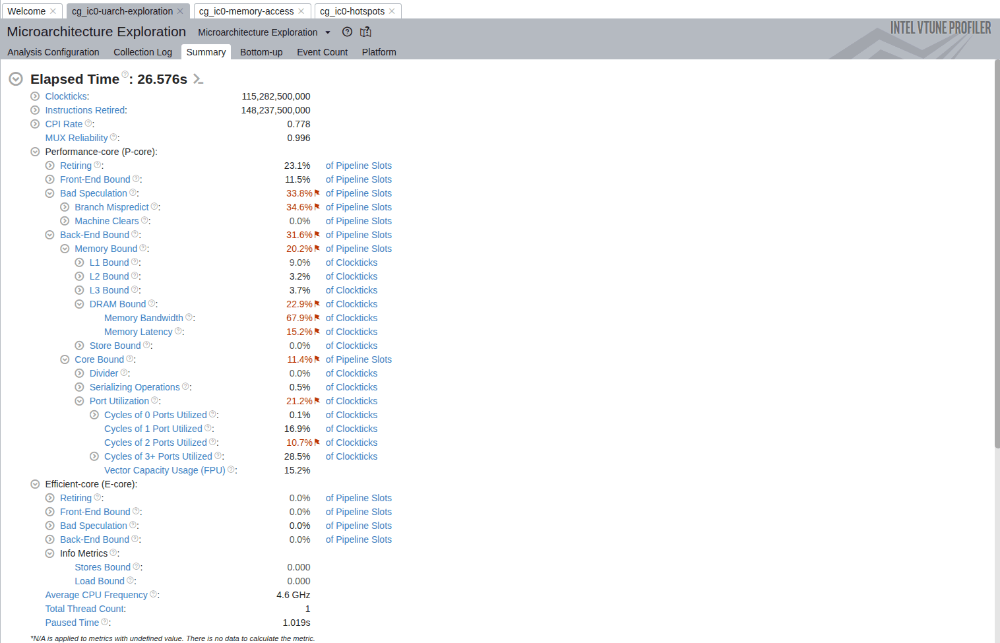 | 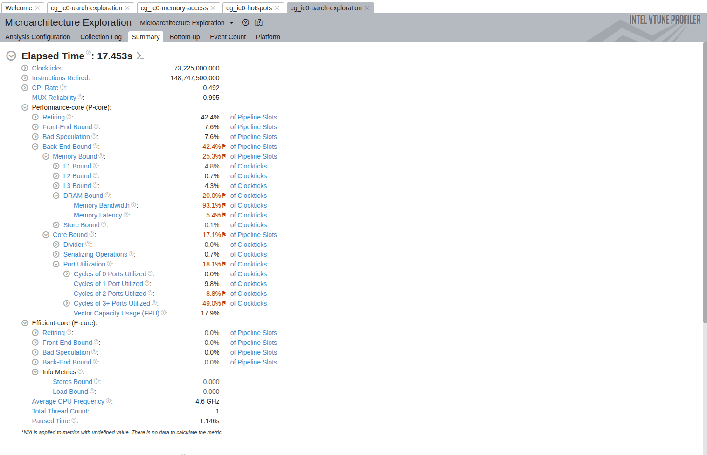 |

Šta pokazati: CPI Rate, Bad Speculation (crveno prije, bez zastavice poslije) i Retiring (23% → 42%, procesor radi korisnog posla skoro duplo više). Elapsed Time je pao sa 26,6 s na 17,5 s za isti broj iteracija.

| Prije | Poslije |
| --- | --- |
| 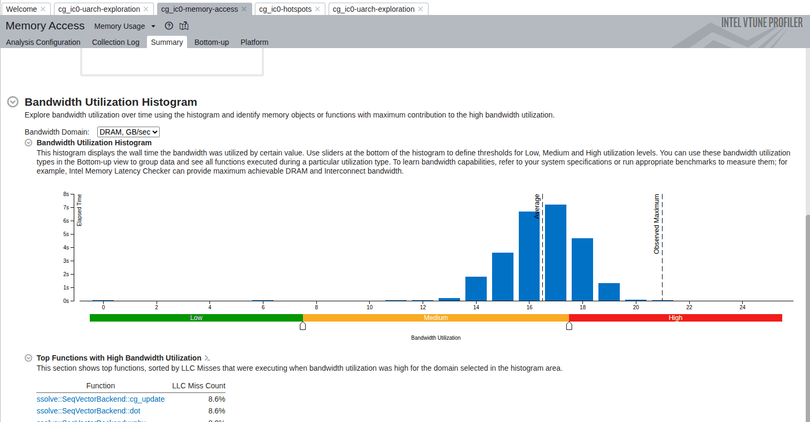 | 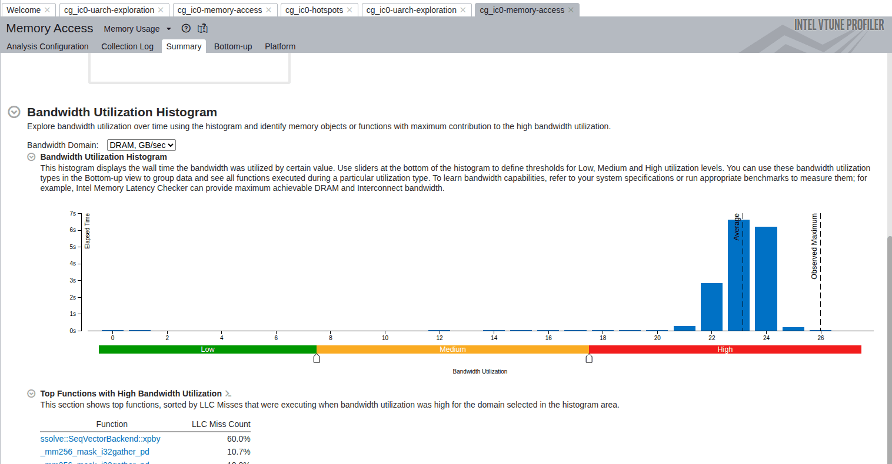 |

Šta pokazati: prije su stubovi oko 14–18 GB/s, većinom u žutom (Medium) pojasu; poslije su na 22–25 GB/s, u crvenom (High) pojasu. Histogram je pomjeren udesno.

| Prije | Poslije |
| --- | --- |
| 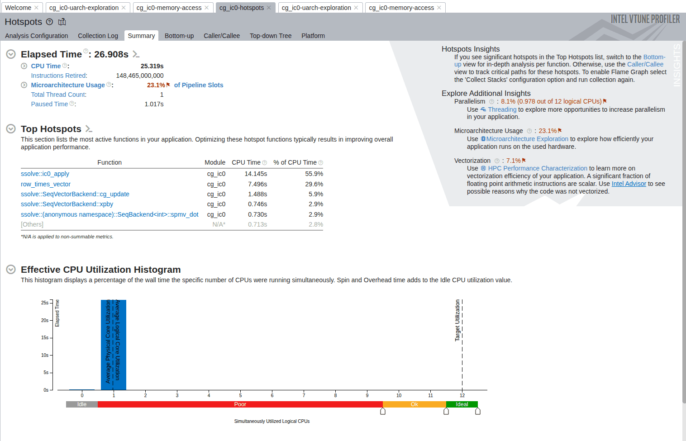 | 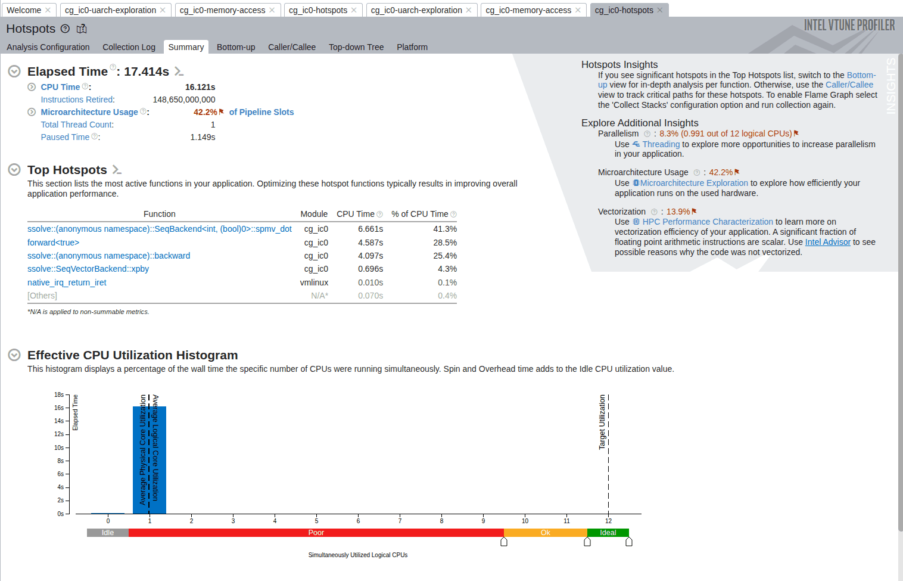 |

Šta pokazati: prije je najtoplija funkcija `ic0_apply` (56% vremena); poslije su to `forward` i `backward`, novi trouglasti kernel, a vrijeme je 25,3 s → 16,1 s.

### `cg_jacobi`: bad speculation 21,6% → 0,0%

| Prije | Poslije |
| --- | --- |
| 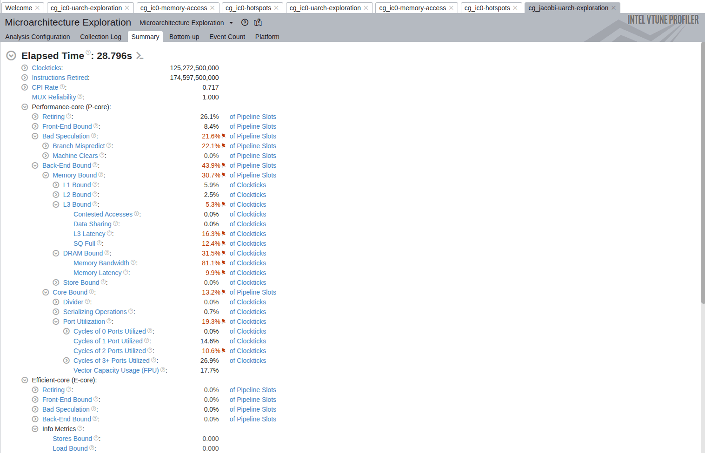 | 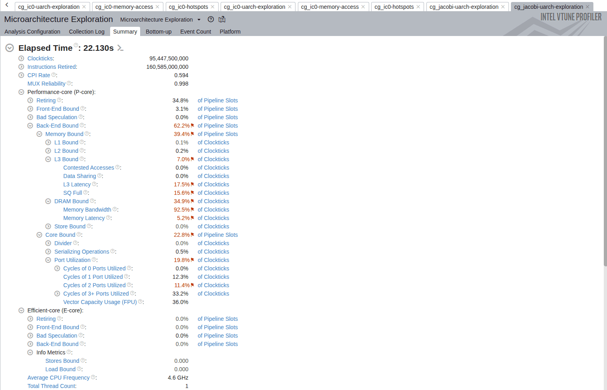 |

Šta pokazati: Bad Speculation 21,6% → 0,0% (množenje matrice i vektora više nema grananja), CPI 0,717 → 0,594.

| Prije | Poslije |
| --- | --- |
| 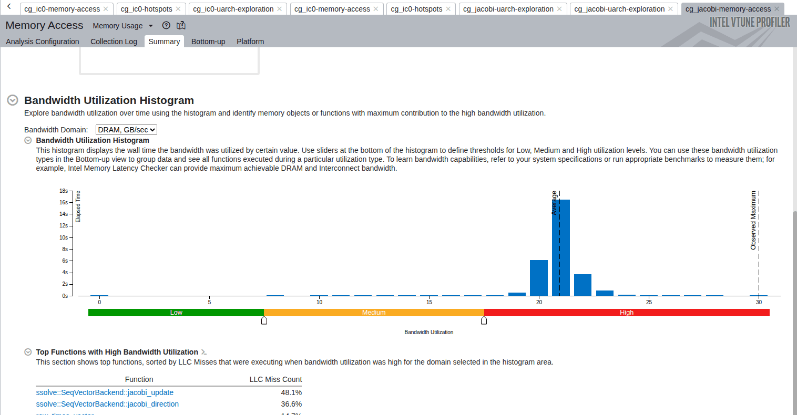 | 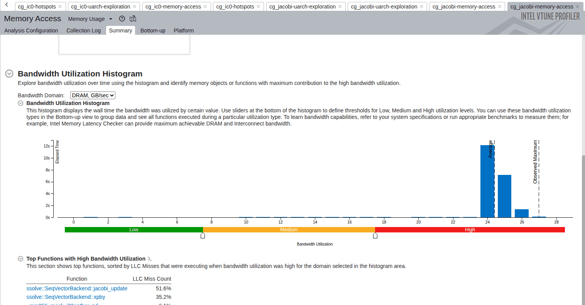 |

| Prije | Poslije |
| --- | --- |
| 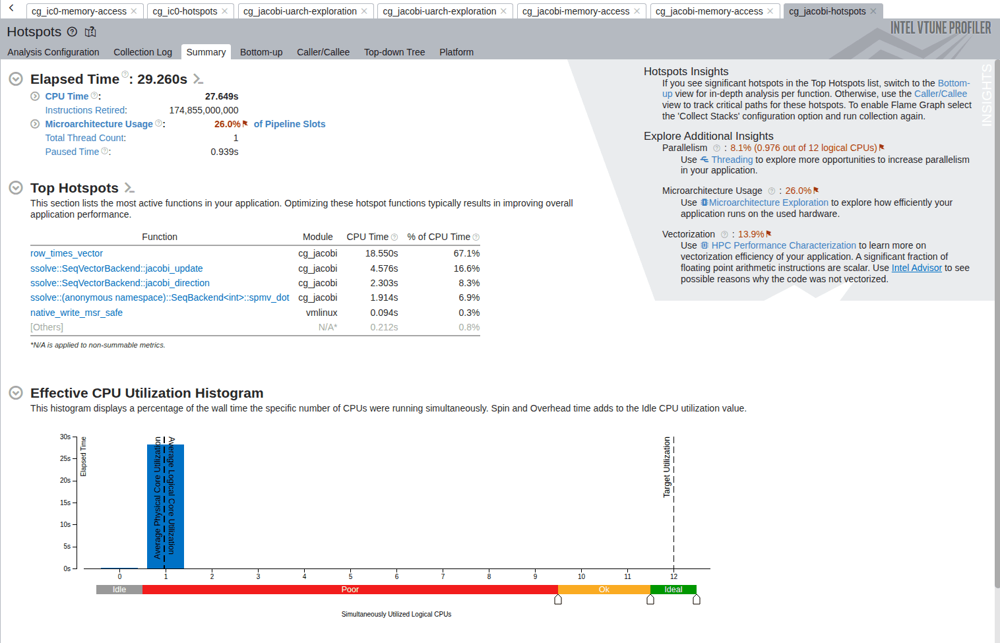 | 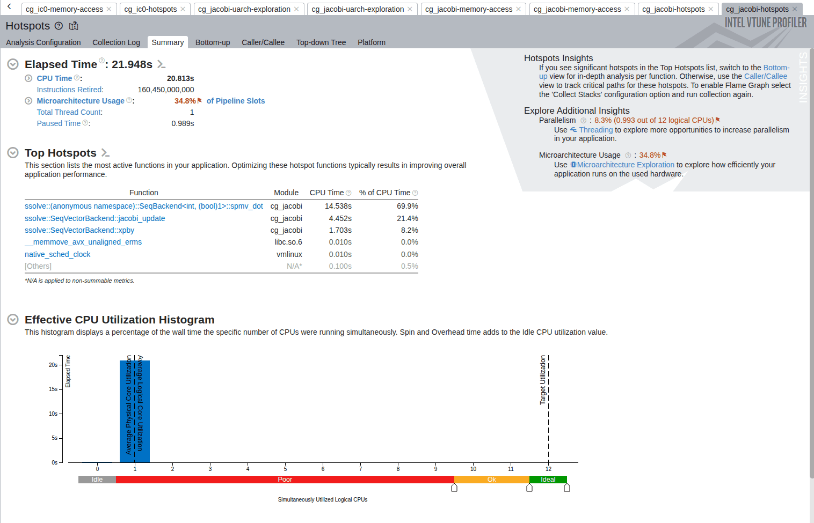 |

### Ostale metode

| Metoda | Microarchitecture | Bandwidth histogram | Hotspots |
| --- | --- | --- | --- |
| `cg_sell_jacobi` | [prije](../results/i5-1335U-linux/vtune-methods/screenshots/cg_sell_jacobi-1-before-uarch.png), [poslije](../results/i5-1335U-linux/vtune-methods/screenshots/cg_sell_jacobi-1-after-uarch.png) | [prije](../results/i5-1335U-linux/vtune-methods/screenshots/cg_sell_jacobi-2-before-memory.png), [poslije](../results/i5-1335U-linux/vtune-methods/screenshots/cg_sell_jacobi-2-after-memory.png) | [prije](../results/i5-1335U-linux/vtune-methods/screenshots/cg_sell_jacobi-3-before-hotspots.png), [poslije](../results/i5-1335U-linux/vtune-methods/screenshots/cg_sell_jacobi-3-after-hotspots.png) |
| `cg_sgs` | [prije](../results/i5-1335U-linux/vtune-methods/screenshots/cg_sgs-1-before-uarch.png), [poslije](../results/i5-1335U-linux/vtune-methods/screenshots/cg_sgs-1-after-uarch.png) | [prije](../results/i5-1335U-linux/vtune-methods/screenshots/cg_sgs-2-before-memory.png), [poslije](../results/i5-1335U-linux/vtune-methods/screenshots/cg_sgs-2-after-memory.png) | [prije](../results/i5-1335U-linux/vtune-methods/screenshots/cg_sgs-3-before-hotspots.png), [poslije](../results/i5-1335U-linux/vtune-methods/screenshots/cg_sgs-3-after-hotspots.png) |
| `cg_ic` | [prije](../results/i5-1335U-linux/vtune-methods/screenshots/cg_ic-1-before-uarch.png), [poslije](../results/i5-1335U-linux/vtune-methods/screenshots/cg_ic-1-after-uarch.png) | [prije](../results/i5-1335U-linux/vtune-methods/screenshots/cg_ic-2-before-memory.png), [poslije](../results/i5-1335U-linux/vtune-methods/screenshots/cg_ic-2-after-memory.png) | [prije](../results/i5-1335U-linux/vtune-methods/screenshots/cg_ic-3-before-hotspots.png), [poslije](../results/i5-1335U-linux/vtune-methods/screenshots/cg_ic-3-after-hotspots.png) |
| `cg_ic_fixed` | [prije](../results/i5-1335U-linux/vtune-methods/screenshots/cg_ic_fixed-1-before-uarch.png), [poslije](../results/i5-1335U-linux/vtune-methods/screenshots/cg_ic_fixed-1-after-uarch.png) | [prije](../results/i5-1335U-linux/vtune-methods/screenshots/cg_ic_fixed-2-before-memory.png), [poslije](../results/i5-1335U-linux/vtune-methods/screenshots/cg_ic_fixed-2-after-memory.png) | [prije](../results/i5-1335U-linux/vtune-methods/screenshots/cg_ic_fixed-3-before-hotspots.png), [poslije](../results/i5-1335U-linux/vtune-methods/screenshots/cg_ic_fixed-3-after-hotspots.png) |
| `cg_ic0_rcm` | [prije](../results/i5-1335U-linux/vtune-methods/screenshots/cg_ic0_rcm-1-before-uarch.png), [poslije](../results/i5-1335U-linux/vtune-methods/screenshots/cg_ic0_rcm-1-after-uarch.png) | [prije](../results/i5-1335U-linux/vtune-methods/screenshots/cg_ic0_rcm-2-before-memory.png), [poslije](../results/i5-1335U-linux/vtune-methods/screenshots/cg_ic0_rcm-2-after-memory.png) | [prije](../results/i5-1335U-linux/vtune-methods/screenshots/cg_ic0_rcm-3-before-hotspots.png), [poslije](../results/i5-1335U-linux/vtune-methods/screenshots/cg_ic0_rcm-3-after-hotspots.png) |

Eigen metode (`eigen_e1`, `eigen_e4`) nemaju screenshotove, jer njihov kod nismo mijenjali; njihove brojke su u tabeli gore.

### Kako otvoriti rezultat u GUI-ju

```bash
source /opt/intel/oneapi/setvars.sh
vtune-gui
```

U VTune-u: **Open Result…** i izabrati `.vtune` fajl, npr. `~/p08/vtune-methods/optimized/cg_ic0-uarch-exploration/cg_ic0-uarch-exploration.vtune` (poslije) ili `~/p08/vtune-methods/baseline/cg_ic0-uarch-exploration/…` (prije). Rezultati prije za `cg_ic0` i `cg_jacobi` su već raspakovani; ostali su u `~/p08/vtune-methods/baseline/*.tar.zst` i raspakuju se sa `tar --zstd -xf cg_sgs-uarch-exploration.tar.zst`.
