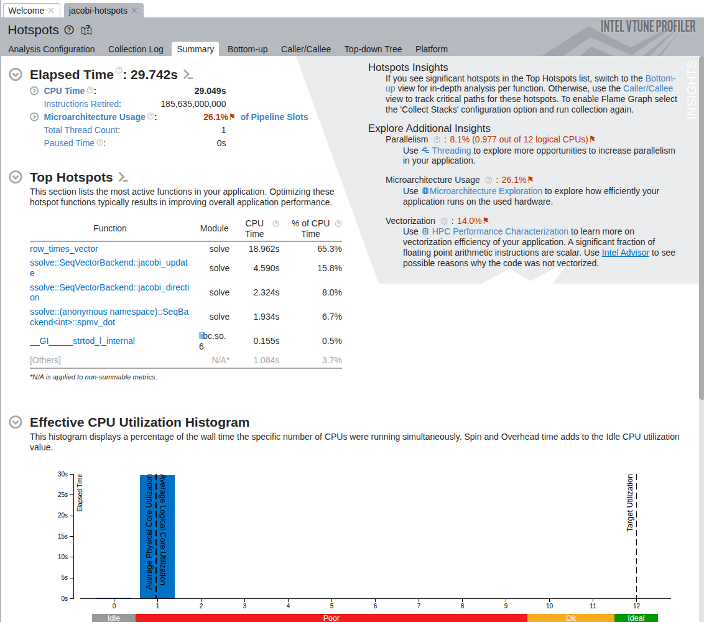
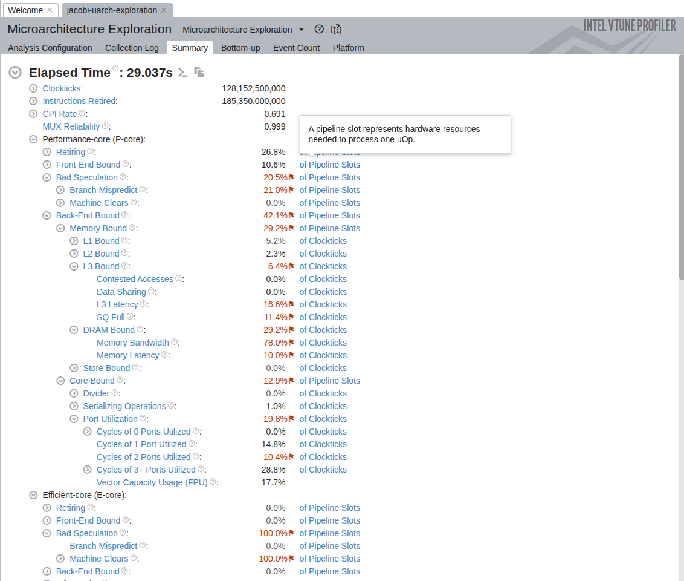
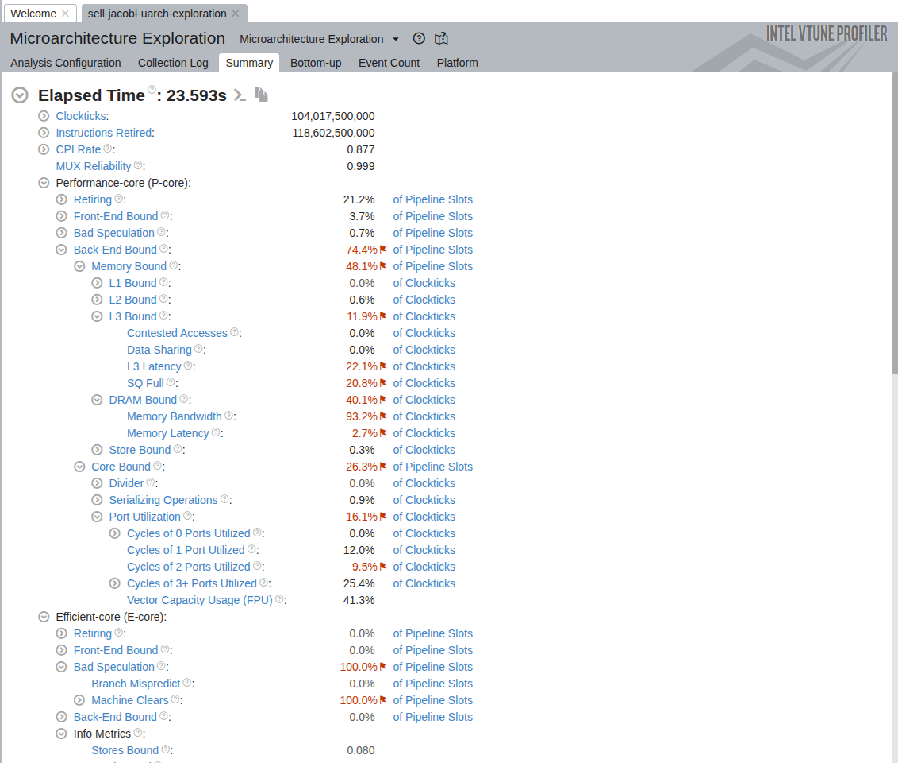
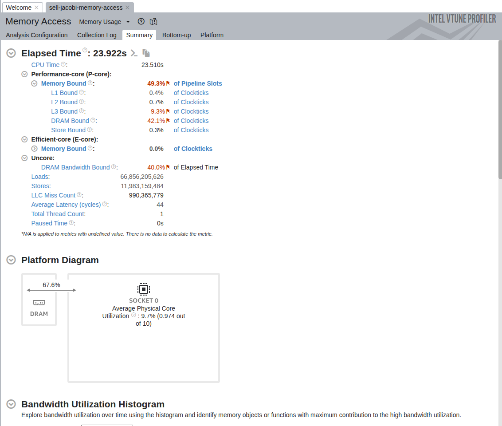
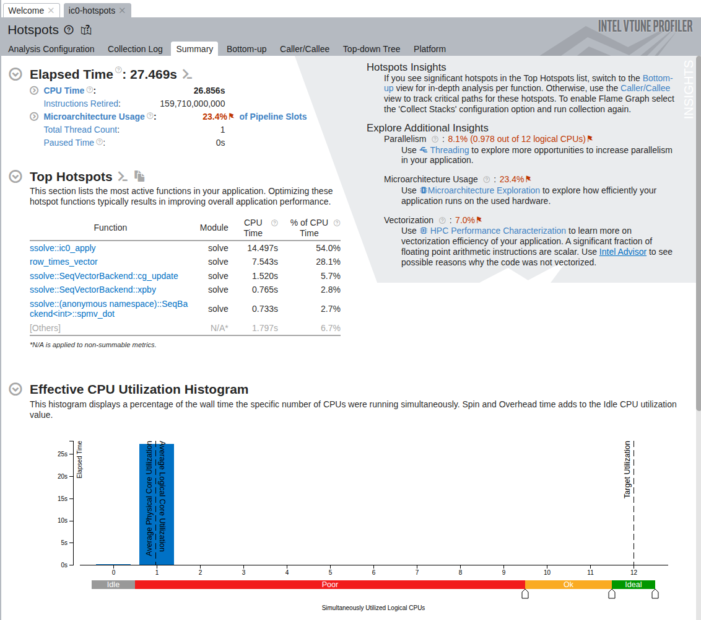
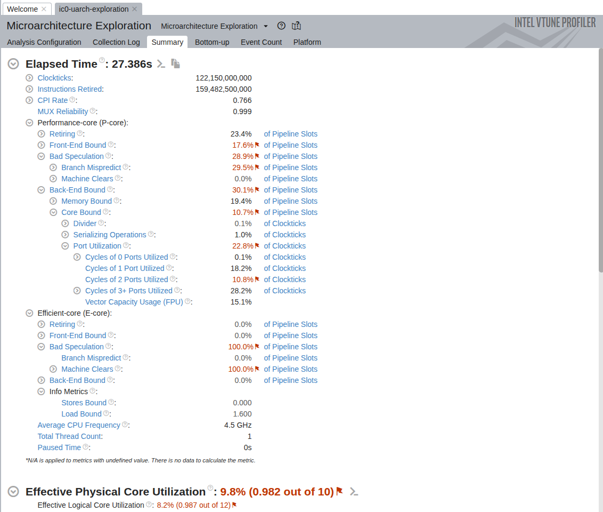
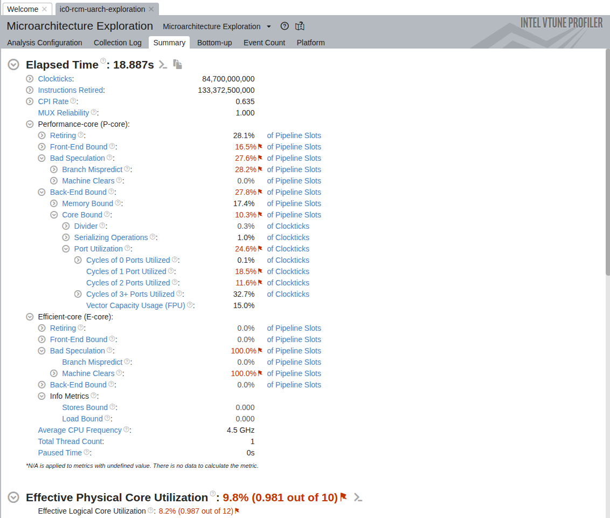
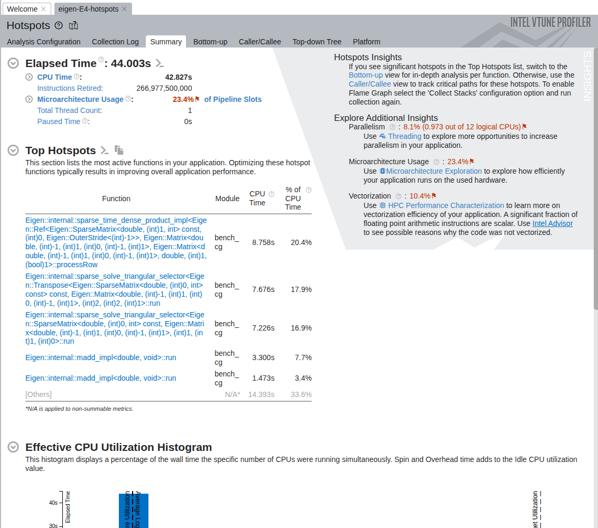

# VTune profile: thermal2 on i5-1335U under Linux

Where each solver spends its time on `thermal2` (1,228,045 rows, 8,580,313 non-zeros, 7 per row), and what the processor is waiting for while it is there. Measured with Intel VTune Profiler 2026.6 and its sampling driver on Ubuntu 24.04, kernel 6.17, at commit `6031eee`, `profile` preset (the release flags plus symbols and frame pointers), pinned to performance core 0, on AC power.

Every run solves the benchmark's random problem to tol 1e-8. Reproduce with:

```bash
source /opt/intel/oneapi/setvars.sh
sudo sysctl kernel.perf_event_paranoid=0 kernel.kptr_restrict=0 kernel.yama.ptrace_scope=0
sudo /opt/intel/oneapi/vtune/latest/sepdk/src/insmod-sep -g "$(id -gn)"
scripts/profile_vtune.sh ~/p08/data/thermal2.mtx results/i5-1335U-linux/vtune
```

The text reports are in [results/i5-1335U-linux/vtune](../../results/i5-1335U-linux/vtune), and the screenshots of the VTune window in [vtune-i5-1335U-linux](vtune-i5-1335U-linux).

## Findings

1. **Our plain SpMV loses more to mispredicted branches than to memory.** In `row_times_vector`, 27% of the pipeline slots are bad speculation and 18% are memory bound. A row has 7 entries, so the inner loop ends after three or four turns and the processor guesses the exit wrong.
2. **SELL-C-σ removes those mispredictions, and then memory is the limit.** Bad speculation falls from 20.5% to 0.7% for the whole run. The multiply needs half the instructions (32 M against 63 M per product) and 29% fewer cycles. What remains is 48% memory bound, and the run draws 25.6 GB/s from memory on average against 19.8 GB/s with CSR.
3. **The triangular solves are limited by branches, not by cache misses.** `ic0_apply` and `incomplete_cholesky_apply` show 36% bad speculation and 20 to 23% front-end bound, but only 11 to 14% memory bound.
4. **The Eigen-style factor is slower to apply for two reasons.** One application of `ic` executes 117 M instructions against 84 M for `ic0`, and misses the last-level cache 296,000 times against 107,000. The guess that Eigen's column order costs cache misses holds: 2.8 times as many.
5. **RCM helps twice.** With `ic0`, reordering cuts the iterations from 927 to 753, and each one gets cheaper. Last-level cache misses per multiply fall from 62,000 to 22,000 and per `ic0_apply` from 107,000 to 56,000; `ic0_apply` runs the same instructions in 24% fewer cycles.
6. **The vector updates are pure memory bandwidth.** `jacobi_update`, `jacobi_direction` and `cg_update` sit at 2.0 to 2.5 cycles per instruction and 65 to 67% memory bound.
7. **Against Eigen with Jacobi, the multiply is the same and the vector work is not.** Both multiplies run about 62 M instructions in 36 M cycles. Over the whole solve Eigen misses the last-level cache 2.07 billion times and we 0.91 billion, because Eigen passes over the vectors separately where our kernels are merged.

## Time per solver

Hotspots analysis, hardware sampling. "Per iteration" divides the function's CPU time by the iteration count.

| Solver | Iterations | Solve time (s) | Hottest function | Share | Per iteration (ms) | Multiply per iteration (ms) |
| --- | ---: | ---: | --- | ---: | ---: | ---: |
| `jacobi` | 2,347 | 28.8 | `row_times_vector` (SpMV) | 65.3% | 8.08 | 8.08 |
| `jacobi --format sell` | 2,346 | 22.3 | `chunk_times_vector` (SpMV) | 57.0% | 5.54 | 5.54 |
| `sgs` | 992 | 33.4 | `SymGaussSeidel::apply` | 58.7% | 19.79 | 8.17 |
| `ic` | 1,525 | 50.8 | `incomplete_cholesky_apply` | 60.8% | 20.36 | 8.13 |
| `ic-fixed` | 1,297 | 43.0 | `incomplete_cholesky_apply` | 60.4% | 20.23 | 8.04 |
| `ic0` | 927 | 26.4 | `ic0_apply` | 54.0% | 15.64 | 8.14 |
| `ic0 --order rcm` | 753 | 17.9 | `ic0_apply` | 48.3% | 11.97 | 6.90 |
| `eigen-E1` (Jacobi) | 2,346 | 36.9 | `sparse_time_dense_product_impl::processRow` (SpMV) | 48.4% | 7.54 | 7.54 |
| `eigen-E4` (incomplete Cholesky) | 1,133 | 42.5 | two triangular solves | 34.8% | 13.16 | 7.73 |

- **Jacobi:** two thirds of the time is the multiply, as expected. The rest is the two merged vector kernels and the dot product inside the multiply.
- **Preconditioners:** applying the preconditioner costs one and a half to two and a half multiplies, and is the largest item in every preconditioned run.
- **Eigen:** its time is spread over many small inlined functions (`_mm256_mul_pd`, `madd_impl`, `memset`), so the multiply's own share looks smaller than ours.
- **`ic` against `eigen-E4`:** they need 1,525 and 1,133 iterations on this matrix, as under WSL2 (1,526 and 1,133). The accuracy gate passes this as a plateau, but their times here are not a like-for-like comparison.

## What the processor waits for

Microarchitecture Exploration, performance core, whole run. The first four columns are shares of pipeline slots and add up to 100%.

| Solver | Retiring (useful) | Front-end bound | Bad speculation | Back-end bound | of which memory | of which core | Cycles per instruction |
| --- | ---: | ---: | ---: | ---: | ---: | ---: | ---: |
| `jacobi` | 26.8% | 10.6% | 20.5% | 42.1% | 29.2% | 12.9% | 0.69 |
| `jacobi --format sell` | 21.2% | 3.7% | 0.7% | 74.4% | 48.1% | 26.3% | 0.88 |
| `sgs` | 30.4% | 12.3% | 22.8% | 34.5% | 22.5% | 12.0% | 0.60 |
| `ic` | 23.4% | 16.4% | 29.7% | 30.4% | 20.0% | 10.4% | 0.75 |
| `ic-fixed` | 23.4% | 16.5% | 29.5% | 30.6% | 20.1% | 10.4% | 0.75 |
| `ic0` | 23.4% | 17.6% | 28.9% | 30.1% | 19.4% | 10.7% | 0.77 |
| `ic0 --order rcm` | 28.1% | 16.5% | 27.6% | 27.8% | 17.4% | 10.3% | 0.64 |
| `eigen-E1` | 23.6% | 10.4% | 16.7% | 49.3% | 37.5% | 11.8% | 0.74 |
| `eigen-E4` | 23.2% | 18.7% | 27.3% | 30.8% | 20.7% | 10.1% | 0.73 |

The same breakdown for the hot functions, per call:

| Solver | Function | Share of cycles | Bad speculation | Memory bound | Instructions (M) | Cycles (M) |
| --- | --- | ---: | ---: | ---: | ---: | ---: |
| `jacobi` | `row_times_vector` | 65.6% | 27.3% | 18.4% | 63.4 | 35.8 |
| `jacobi --format sell` | `chunk_times_vector` | 57.5% | 0.5% | 42.1% | 31.9 | 25.5 |
| `eigen-E1` | `processRow` | 50.7% | 26.9% | 16.4% | 61.5 | 35.6 |
| `ic0 --order rcm` | `row_times_vector` | 28.2% | 30.1% | 12.5% | 63.5 | 31.7 |
| `sgs` | `SymGaussSeidel::apply` | 59.4% | 25.3% | 17.0% | 163.4 | 89.7 |
| `ic` | `incomplete_cholesky_apply` | 60.9% | 36.0% | 13.7% | 116.6 | 91.4 |
| `ic-fixed` | `incomplete_cholesky_apply` | 60.6% | 35.9% | 13.8% | 116.6 | 91.8 |
| `ic0` | `ic0_apply` | 54.4% | 36.2% | 11.4% | 84.4 | 71.7 |
| `ic0 --order rcm` | `ic0_apply` | 48.5% | 34.3% | 9.8% | 84.8 | 54.6 |
| `jacobi` | `jacobi_update` | 15.7% | 1.6% | 64.7% | 3.7 | 8.5 |

## Memory

Memory Access analysis. LLC is the last-level cache, 12 MB here; a miss goes to main memory. The platform's maximum bandwidth, as VTune measured it, is 38 GB/s.

| Solver | Loads (billions) | LLC misses (millions) | LLC misses per iteration | Average bandwidth (GB/s) | Peak bandwidth (GB/s) |
| --- | ---: | ---: | ---: | ---: | ---: |
| `jacobi` | 76.6 | 905 | 386,000 | 19.8 | 25.5 |
| `jacobi --format sell` | 66.9 | 990 | 422,000 | 25.6 | 32.3 |
| `sgs` | 96.7 | 644 | 649,000 | 17.0 | 31.4 |
| `ic` | 116.7 | 1,184 | 776,000 | 14.3 | 24.7 |
| `ic-fixed` | 97.4 | 940 | 725,000 | 14.3 | 24.5 |
| `ic0` | 63.7 | 549 | 592,000 | 15.7 | 24.9 |
| `ic0 --order rcm` | 51.9 | 419 | 556,000 | 17.8 | 24.5 |
| `eigen-E1` | 79.9 | 2,069 | 882,000 | 20.6 | 26.3 |
| `eigen-E4` | 90.4 | 1,329 | 1,173,000 | 13.8 | 25.5 |

Per call of the hot functions:

| Solver | Function | Loads (M) | LLC misses | Average load latency (cycles) |
| --- | --- | ---: | ---: | ---: |
| `jacobi` | `row_times_vector` | 28.1 | 53,000 | 15 |
| `jacobi --format sell` | `chunk_times_vector` | 21.1 | 110,000 | 25 |
| `ic0` | `row_times_vector` | 28.2 | 62,000 | 12 |
| `ic0 --order rcm` | `row_times_vector` | 27.6 | 22,000 | 13 |
| `sgs` | `SymGaussSeidel::apply` | 60.8 | 235,000 | 16 |
| `ic` | `incomplete_cholesky_apply` | 40.6 | 296,000 | 17 |
| `ic-fixed` | `incomplete_cholesky_apply` | 34.8 | 298,000 | 20 |
| `ic0` | `ic0_apply` | 34.6 | 107,000 | 15 |
| `ic0 --order rcm` | `ic0_apply` | 34.4 | 56,000 | 12 |
| `jacobi` | `jacobi_update` | 1.5 | 184,000 | 223 |

- **Only SELL presses on the memory bandwidth.** It is the one run VTune reports at high bandwidth utilization, for 40% of its time; every other run is at 0%.
- **The vector updates wait longest per load.** `jacobi_update` makes few loads, but each waits 223 cycles on average, against 15 in the multiply.
- **RCM removes two thirds of the multiply's misses.** The likely reason, not measured directly: the matrix arrays are read in order, which the prefetcher follows, so the misses left are the indirect reads of `x`, and RCM brings those close together.

## Screenshots

Red flags are VTune marking a metric as above its threshold. Each solver has a Hotspots, a Microarchitecture Exploration and a Memory Access summary in [vtune-i5-1335U-linux](vtune-i5-1335U-linux).

Jacobi with CSR: a fifth of the slots are lost to bad speculation.





Jacobi with SELL: bad speculation is gone and memory is the limit.





IC(0): the triangular solves dominate, and branch misprediction is the largest loss.





IC(0) with RCM, the fastest combination:



Eigen's incomplete Cholesky:



## What this does not show

- **One matrix.** `thermal2` has short rows. On the five matrices with 44 to 82 entries per row the inner loops run longer, so the misprediction share should be smaller. That was not measured.
- **Some flags are expected.** The solver is sequential, so VTune's 8.3% parallelism flag says only that one of twelve logical CPUs is busy. The efficiency-core rows are noise: the run is pinned to a performance core.
- **Setup is not profiled separately.** Factorization takes 0.5 s of a 50 s `ic` run, too little to show in these reports.
- **Use these runs for shares, not for speed.** Profiling adds its own overhead. Speed comparisons belong to the benchmark CSVs.
- **Without the sampling driver the picture is incomplete.** Driverless hotspots and memory-access lost most of their samples on this hybrid processor (0.1 s of CPU time reported for a 28 s solve); Microarchitecture Exploration still worked.
