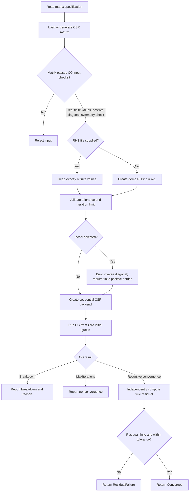

# Sequential Solver Flow

This document describes the current sequential FP64 CG implementation. It uses CSR. SELL storage and OpenMP solver parallelism are not part of the current delivery.

## Steps

1. **Load the matrix.** The input is a Matrix Market file or a supported
   generated matrix. The production executable uses shared matrix-loading
   utilities from the core library.
2. **Check CG requirements.** Reject an empty or nonsquare matrix, non-finite
   values, a nonpositive diagonal, or a matrix that fails the symmetry
   diagnostic. These checks do not prove positive definiteness; inputs must
   come from a source known to provide an SPD matrix.
3. **Select the right-hand side.** With `--rhs FILE`, read exactly `n`
   whitespace-separated finite values. Without it, use the manufactured/demo
   system `b = A*1`.
4. **Validate solver options.** The tolerance must be finite and positive;
   the maximum iteration count must be nonnegative (`0` selects the default).
5. **Prepare the preconditioner and backend.** Plain CG needs no preconditioner.
   Jacobi requires every diagonal and inverse-diagonal value to be finite and
   positive. The solver then constructs the sequential CSR backend.
6. **Run CG.** The normal CLI path starts with `x = 0`. Invalid curvature or
   non-finite intermediate arithmetic returns `Breakdown`. Reaching the
   iteration limit returns `MaxIterations`; neither indicates success.
7. **Verify convergence independently.** `verified_cg` calls `cg`, then recomputes
   `b - A*x` and its relative 2-norm with a separate reference SpMV, using the CSR
   matrix the caller wanted solved rather than whatever the backend holds. A wrong
   kernel or format therefore cannot hide itself, and future backends need no CSR
   copy. For zero `b`, it uses the absolute residual. A non-finite result or a
   residual above tolerance cannot return `Converged`; it reports `Breakdown` or
   `ResidualFailure`, respectively.
8. **Report timing and status.** Preparation, setup, solve, verification, and
   end-to-end times are printed separately. Solve time includes initialization
   and workspace allocation, but excludes verification, printing and file output.
   The exit status is `0` only for verified convergence, `2` for a numerical or
   convergence failure, and `1` for invalid input.

## Relevant Code

- Solver loop and numerical checks: [`src/solvers/cg.cpp`](../src/solvers/cg.cpp)
- Solver statuses and options: [`include/ssolve/solver.hpp`](../include/ssolve/solver.hpp)
- Matrix checks and independent residual: [`src/verify.cpp`](../src/verify.cpp)
- CLI, RHS input, and timing: [`apps/solve.cpp`](../apps/solve.cpp)
